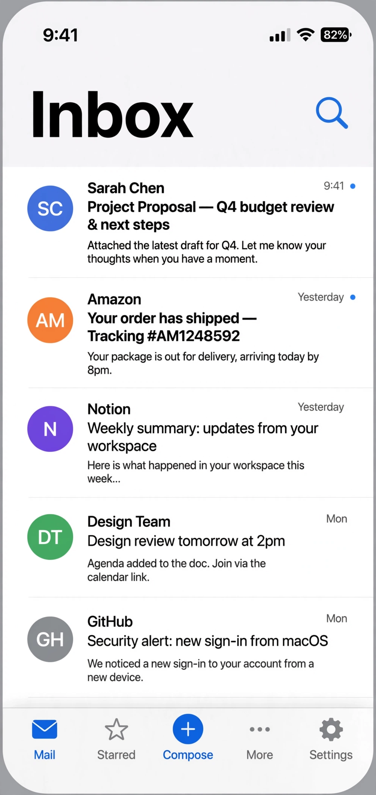

# Open Mail

自托管邮箱完整方案：Cloudflare Worker 后端 + Vue 网页端 + Flutter Android App。邮件收发、未读管理、星标、写信，一个仓库全搞定。



## 包含什么

```
open-mail/
├── mail-worker/    # Cloudflare Worker 后端（D1 + API）
├── mail-vue/       # Vue 网页端
└── mail-flutter/   # Flutter Android App
```

- **mail-worker/**：REST API（`/api`），D1 存邮件，支持多发件通道。
- **mail-vue/**：iOS 风格网页邮箱，移动端底部 Tab 导航。
- **mail-flutter/**：原生 Flutter App，调同一套 `/api` 接口。

## 快速开始

### 后端

```bash
cd mail-worker
# 建 D1 数据库，把 ID 填进 wrangler.toml（your-d1-database-id）
npx wrangler d1 execute DB --file=schema.sql
npx wrangler deploy
```

### 网页端

```bash
cd mail-vue
pnpm install
pnpm build    # 产物按 .env 配置输出
```

### App

```bash
cd mail-flutter
# lib/core/api.dart 里 kSiteBase 换成你的后端地址
flutter build apk
```

## 配置

- 后端：`wrangler.toml` 填 D1/KV 的真实 ID；发件通道、域名等走环境变量。
- App：`lib/core/api.dart` 顶部 `kSiteBase = 'https://your-mail-server.example.com'`。

## 说明

- 后端与网页端 fork 自上游开源项目，保留原 MIT License 与上游署名，详见 `LICENSE`。
- 示例配置全是占位符，部署前换成你自己的。

MIT License（上游署名见 LICENSE）。
